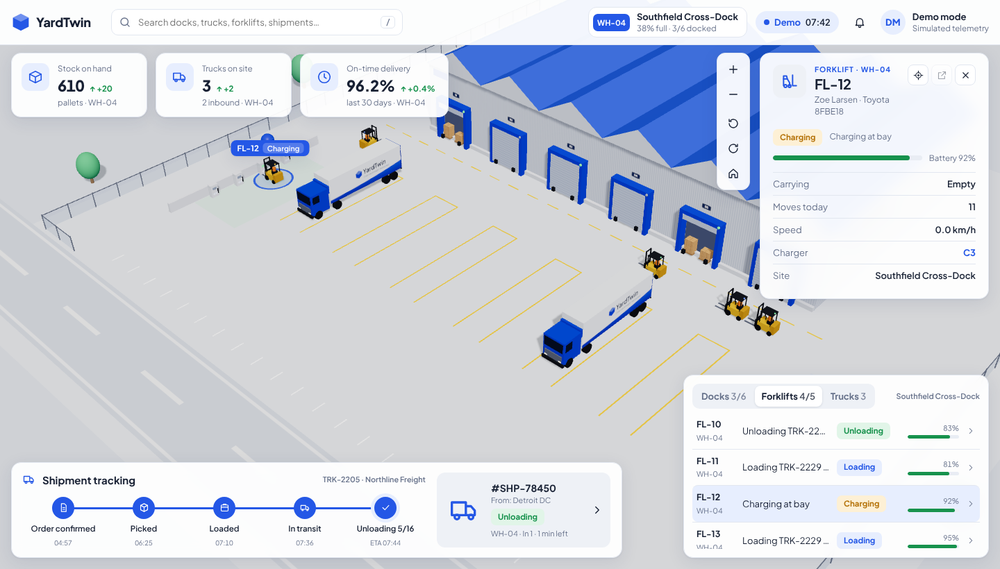

# Digital-twin-3js

A live 3D digital twin of a cross-dock warehouse yard, built with **three.js** and fed by **ThingsBoard** IoT telemetry.

It shows the yard in 3D: the warehouse with six dock doors, trucks reversing into bays, forklifts shuttling pallets, and a charging bay. A control-room HUD sits on top with KPIs, a detail card, shipment tracking, a fleet list, search and alerts.



## Run it

No build step or dependencies. Serve the folder over HTTP:

```bash
npm start            # npx http-server on http://localhost:5173
# or: python3 -m http.server 5173
```

The page opens in **Demo** mode with a built-in simulator. To switch to live data, click the **Demo/Live** pill in the top bar and sign in to ThingsBoard.

## Connect ThingsBoard

### 1. Create devices and stream telemetry

`tools/tb-simulator.mjs` provisions every device in your tenant, then pushes telemetry once a second through the device HTTP API (`/api/v1/{token}/telemetry`). It uses the same simulator as demo mode.

```bash
TB_HOST=http://localhost:8080 TB_USER=tenant@thingsboard.org TB_PASS=tenant npm run simulate
```

It creates 22 devices:

| Device type | Names | Client attributes | Telemetry keys |
|---|---|---|---|
| `site` | `WH-04` | `code`, `name`, `capacity` | `stockOnHand`, `stockDelta`, `trucksOnSite`, `trucksInbound`, `onTimeDelivery`, `onTimeDelta`, `utilisation`, `docksOccupied`, `docksTotal` |
| `forklift` | `FL-10` … `FL-14` | `operator`, `model` | `status`, `task`, `battery`, `speed`, `carrying`, `load`, `movesToday`, `x`, `z`, `heading`, `charger`, `truck`, `dock` |
| `truck` | `TRK-2205` … | `carrier` | `status`, `phase`, `task`, `dir`, `onSite`, `dock`, `x`, `z`, `heading`, `speed`, `pallets`, `moved`, `forklifts`, `eta`, `doneAt`, `shipment` (JSON) |
| `dock` | `WH-04-D1` … `D6` | `code`, `name`, `kind`, `index` | `doorOpen` (0–1), `truck`, `forklifts` |
| `charger` | `WH-04-C1` … `C4` | `code`, `index` | `busy`, `forklift` |

Positions are in yard metres (`x` towards the warehouse, `z` along the façade). `heading` is in radians, with 0 pointing towards the warehouse. With real hardware, map your RTLS, telematics or PLC data to these keys, for example with a Rule Chain script node, and the twin picks them up unchanged.

### 2. Point the twin at your server

In the twin, open **Demo → Connect to ThingsBoard**. Enter the server URL and either a username and password or a JWT. The twin then:

1. signs in with `POST /api/auth/login` (and refreshes the token with `/api/auth/token`);
2. lists devices by type, using `/api/tenant/devices?type=…` for tenant users or `/api/customer/{id}/devices` for customer users;
3. opens the WebSocket API (`/api/ws` with `authCmd`). On older servers it falls back to `/api/ws/plugins/telemetry`;
4. subscribes to `LATEST_TELEMETRY` and `CLIENT_SCOPE` attributes for each device, then merges updates into the scene. Positions are interpolated between updates so motion stays smooth at 1 Hz.

The **open** button in the detail card links to the device page in ThingsBoard.

**CORS:** the browser calls ThingsBoard directly. If the twin is hosted on a different origin, allow that origin in ThingsBoard's `spring.mvc.cors` settings (`thingsboard.yml`). Alternatively, host the twin on the same domain behind your reverse proxy.

The host URL and username are remembered in `localStorage`. Passwords and tokens are never stored.

## Project layout

```
index.html               generated page (npm run build)
src/app.html             HUD markup
src/styles.css           theme tokens (light + dark) and layout
src/main.js              wiring: world + UI + data source
src/model/layout.js      shared yard geometry (metres)
src/model/simulation.js  yard simulator: trucks, docks, forklifts, chargers, shipments
src/data/sim-source.js   demo source (runs the simulator in the page)
src/data/thingsboard.js  ThingsBoard REST + WebSocket source
src/scene/world.js       three.js scene, camera, picking, interpolation
src/scene/models.js      procedural forklift, truck, charger, pallets, props
src/scene/textures.js    canvas textures (no image assets)
src/ui/ui.js             KPIs, detail card, shipment tracker, fleet list, search, alerts
tools/tb-simulator.mjs   provisions devices and streams telemetry to ThingsBoard
tools/build.mjs          assembles index.html (and dist/artifact.html)
```

## Controls

- Drag to orbit, right-drag to pan, scroll to zoom. The camera buttons also zoom, rotate and reset the view.
- Click any forklift, truck, dock door or charger to open its card. The **target** button follows it as it moves.
- Press <kbd>/</kbd> to search by device, operator, carrier, shipment or partner.
